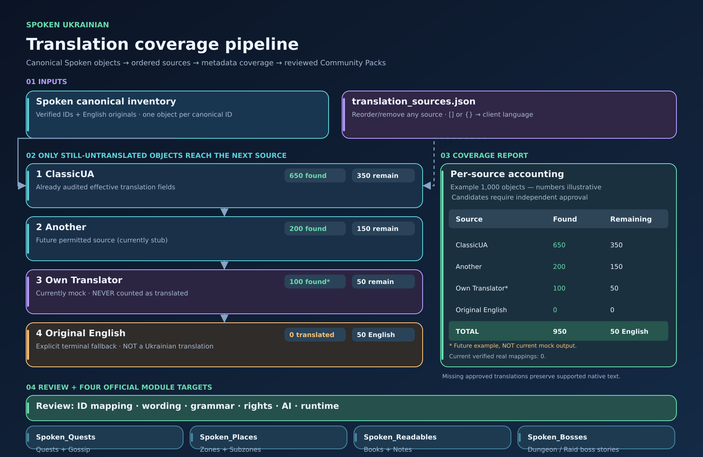

# Spoken Ukrainian 🇺🇦

**[English](README.md) | [Українська](README.uk.md)**

**Spoken Ukrainian** is a community project bringing Ukrainian text localization and, in the future, Ukrainian voice narration to [Spoken](https://github.com/rusty-key/spoken-wow) for **World of Warcraft Forever**. It is developed as an independent collection of Spoken Community Packs; the original Spoken Player remains a separate dependency.

> **Development status:** Ukrainian language registration and an original text-only **Places diagnostic pack** have been implemented and manually tested in Forever. The ClassicUA source adapter is implemented. Full Ukrainian quest, dialogue, book, location and boss-story packs **have not yet been released**.

## Architecture and translation flow

Spoken Ukrainian prepares Ukrainian content **offline** for the **unmodified Spoken Player**. Discovering a translation does **not** approve its canonical Spoken identity, text quality, content rights or runtime compatibility.

### Four approved modules

| Official module | Planned Ukrainian content |
| --- | --- |
| `Spoken_Quests` | Quests **and Gossip** (one module, not two) |
| `Spoken_Places` | Zone/subzone lore (formerly Spoken Zones) |
| `Spoken_Readables` | Books, letters, notes, plaques (formerly Spoken Books) |
| `Spoken_Bosses` | Dungeon and raid boss stories |

These are **official module targets**, not a player fork. Four independently installable Ukrainian content packs are planned. ClassicUA does **not** supply authored Places/Bosses stories. See the [approved product and fallback policy](docs/APPROVED_MODULES_AND_FALLBACK.md).

### Translation sources and priorities

The default offline provider order is configured in [`config/translation_sources.json`](config/translation_sources.json):

```json
{
  "schema_version": 1,
  "sources": ["classicua", "another", "own_translator", "original_english"]
}
```

| Source | Current state | Role |
| --- | --- | --- |
| `classicua` | Implemented adapter | Read audited effective ClassicUA translation fields; mappings still need review |
| `another` | Offline stub | Future independently licensed source; currently finds nothing |
| `own_translator` | Non-publishable mock | Does **not** count as a translation or consume a record |
| `original_english` | Explicit fallback | Select original English for still-unresolved records; never count as Ukrainian |

You can **reorder or remove** any entry. `["own_translator", "classicua", "original_english"]` changes priority (the translator is still a mock); `["original_english"]` selects English only. **`{"schema_version":1,"sources":[]}` or `{}` means the genuine WoW client language**, with no provider calls; an actual `deDE` client is not forced to English. The offline caller must supply the client locale. Omitting `original_english` does not silently reinsert it. A missing or invalid config file is an error.

### Sequential processing and coverage

1. Start from a list of **verified canonical Spoken IDs** and original English text/identity evidence. The caller currently supplies this list.
2. Each configured source receives **only records still without a real Ukrainian candidate** from earlier sources. Record source, canonical ID, field SHA-256 and `candidate_pending_review` for discoveries.
3. Mocks do not resolve records. Explicit English and empty-config client language are separate statuses, **not Ukrainian translations**.
4. Produce a **metadata-only report** with per-source new candidates, remaining records, and the total. Never export translation bodies.
5. Independently review matching evidence, text/grammar/AI, attribution/rights and runtime behavior **before any pack**.

**Synthetic example, not actual translation coverage:**

| Source | New Ukrainian candidates | Remaining for next source |
| --- | ---: | ---: |
| ClassicUA | 2 | 2 |
| Another (stub) | 0 | 2 |
| Own Translator (mock) | 0 | 2 |
| Original English | 0 (2 English originals) | 0 |
| **Total: 4 records** | **2 pending review** | **2 English-only** |

The report distinguishes candidate counts from `approved_translations` (**currently zero**), English/client selection and unresolved records. This is an **offline prototype**, not yet integrated with `tools/stage3_report.py` or the final Community Pack builder. **No real source↔Spoken joins are approved.**



[Editable draw.io diagram](docs/diagrams/translation-pipeline.drawio) · [Source chain and accounting specification](docs/TRANSLATION_SOURCE_CHAIN.md) · [Stage 3 identity mapping evidence](docs/STAGE_3_IMPLEMENTATION.md)

### Compatibility and source updates

`ukUA` is a Spoken **content language**, not a Blizzard client locale. Text-only Ukrainian Places diagnostic lore works, but current pinned Spoken has unresolved Quests/Gossip captions, Readables and Bosses display/audio restrictions. **Configurable offline sources do not implement in-game fallback** or fix these limitations. See [Stage 2B](docs/STAGE_2B_COMPATIBILITY.md).

Completed Ukrainian packs should eventually work without requiring the ClassicUA addon at runtime. ClassicUA will remain a **pinned input**, re-audited on approved updates; effective text changes can trigger content/audio review without automatically changing canonical IDs. Pack generation, TTS and publication remain later separately authorized stages.

## ClassicUA and attribution

The project uses **[ClassicUA](https://github.com/greenya/ClassicUA)** as the intended main source of Ukrainian game-text translations and Warcraft terminology. Thank you to its maintainers and contributors for their work.

Maintainer **greenya** granted permission in [ClassicUA issue #100](https://github.com/greenya/ClassicUA/issues/100#issuecomment-6917008199) to use and adapt ClassicUA translations for Spoken Ukrainian and to create and distribute AI TTS narration based on them. The response confirms coverage of the repository's translations, states no additional publication restrictions and requests a project link plus acknowledgement that the translations were adapted.

> **За основу взято адаптовані переклади [ClassicUA](https://github.com/greenya/ClassicUA).**

This attribution applies to **future ClassicUA-derived content**. The existing diagnostic paragraph is original and contains no imported ClassicUA translations. The permission does not automatically cover unrelated artwork, fonts or independently sourced lore, or waive the terms of an eventual TTS provider. See [permission record](docs/CLASSICUA_PERMISSION.md) and [third-party content notes](THIRD_PARTY.md).

## Current status

| Component | Status |
| --- | --- |
| Stage 0 — architecture and source/compatibility review | Complete |
| Stage 1 — `ukUA` registration and original text-only Places diagnostic | Implemented; manually tested in Forever |
| Stage 2A — restricted ClassicUA Lua parser, override resolver and metadata-only audit | Implemented |
| Stage 2B — runtime compatibility of independent Ukrainian text | Offline characterization implemented; [results](docs/STAGE_2B_COMPATIBILITY.md), [manual Forever acceptance pending](docs/STAGE_2B_TESTING.md) |
| Stage 3 — canonical ClassicUA → Spoken ID mapping and update-ready comparison | Offline inventory, review schema and local effective comparison implemented; **0 approved real joins, independent review pending** ([coverage](docs/STAGE_3_IMPLEMENTATION.md)) |
| Configurable source priority and sequential coverage (PR #8) | Offline resolver, policy and candidate metadata reporting implemented; **no approved real content** |
| Stage 4A — real pinned Spoken inventory → source coverage dry-run | Implemented read-only public English text index and offline coverage CLI for verified originals; **0 real source joins, no Ukrainian packs** ([details](docs/STAGE_4A_INVENTORY_COVERAGE.md)) |
| Ukrainian text/audio packs, updater and public releases | Not released |

## Build and test

The current downloadable **local build output is only a diagnostic pack**, not a complete Ukrainian localization.

```sh
python3 tools/version.py check
python3 tools/build.py
python3 -m unittest discover -s tests -v
```

Building requires Python 3. The tests additionally use Git, the system Lua 5.4 shared library and the pinned Spoken source checkout (normally in sibling `../spoken-wow`). Set `SPOKEN_SOURCE=/absolute/path/to/spoken-wow` if yours is elsewhere. These commands do not fetch source code, install packages or access production systems.

The build writes `dist/SpokenCommunity_ukrainian-diagnostic.zip` plus its SHA-256 sidecar. It contains only the addon TOC and `Lore.lua`, with original language/font test text for Elwynn Forest (map 1429). **Do not install the entire repository into AddOns.** See the [Stage 1 installation and testing guide](docs/STAGE_1_TESTING.md) for manual installation.

### Validate offline identities (Stage 3)

```sh
python3 tools/stage3_report.py --classicua /absolute/path/to/clean-pinned-ClassicUA --spoken /absolute/path/to/spoken-wow
```

Writes deterministic metadata only to ignored `build/stage3-report.json`. Optional
`--reviews` validates reviewed attestations. `--candidate` with
`--candidate-manifest` compares a separately reviewed local revision without
changing the active lock. See the [review procedure](docs/STAGE_3_IMPLEMENTATION.md).

### Dry-run source coverage against real Spoken IDs (Stage 4A)

```sh
python3 tools/stage4_coverage.py --spoken /absolute/path/to/clean-pinned-spoken-wow
```

Reads the **real pinned canonical Spoken inventory** and checks original wording for Quests/Gossip/Readables without exporting text; reports a per-source lookup pass, missing-original targets and total counts in ignored `build/stage4-source-coverage.json`. Source identity is deliberately **unbound** until independently approved Stage 3 joins exist, so **no real ClassicUA translation is assigned**; `another` remains a stub and `own_translator` a mock. Empty policy requires an explicit `--client-locale` from the caller. See [Stage 4A scope and limitations](docs/STAGE_4A_INVENTORY_COVERAGE.md).

### Audit a pinned ClassicUA checkout (Stage 2A)

```sh
python3 tools/classicua_audit.py --source /absolute/path/to/clean-pinned-ClassicUA
```

The adapter reads a **separate, clean** ClassicUA checkout at the revision in [sources.lock.json](sources.lock.json), validates source hashes and resolves the real `classic → sod → forever` load/override behavior. Its metadata-only report is stored in ignored `build/classicua-audit.json`. It does not execute ClassicUA source Lua, export translations into packs or match Spoken canonical IDs. See the [implementation](docs/STAGE_2A_IMPLEMENTATION.md) and [test report](docs/STAGE_2A_TESTING.md).

## Project versions

The root [VERSION](VERSION) is the **project** version (initial baseline `0.0.1`), separate from independently versioned community addons (the diagnostic addon is `0.1.0`). Use `python3 tools/version.py show` and `python3 tools/version.py check`; changes are documented in [CHANGELOG.md](CHANGELOG.md). Tags and GitHub Releases are explicit, reviewed operations; they are not automatically created by version bumps. See [VERSIONING.md](docs/VERSIONING.md).

## Documentation

- [Implementation roadmap](docs/IMPLEMENTATION_PLAN.md) · [Source integration](docs/SOURCE_INTEGRATION.md) · [Compatibility matrix](docs/COMPATIBILITY_MATRIX.md)
- [Stage 3 mapping/update specification](docs/STAGE_3_SPECIFICATION.md) · [Permission record](docs/CLASSICUA_PERMISSION.md) · [Attribution](THIRD_PARTY.md)
- [Stage 4A pinned inventory/coverage CLI](docs/STAGE_4A_INVENTORY_COVERAGE.md) · [Translation source architecture](docs/TRANSLATION_SOURCE_CHAIN.md) · [Editable diagram](docs/diagrams/translation-pipeline.drawio) · [Approved four-module policy](docs/APPROVED_MODULES_AND_FALLBACK.md)
- [Spoken Community Packs guide](https://github.com/rusty-key/spoken-wow/blob/master/community/README.md)

Stage 0 documents preserve the **historical state at the time they were written**, including an earlier unresolved-permission note. The subsequent permission is documented separately rather than rewriting their pinned historical contents.
