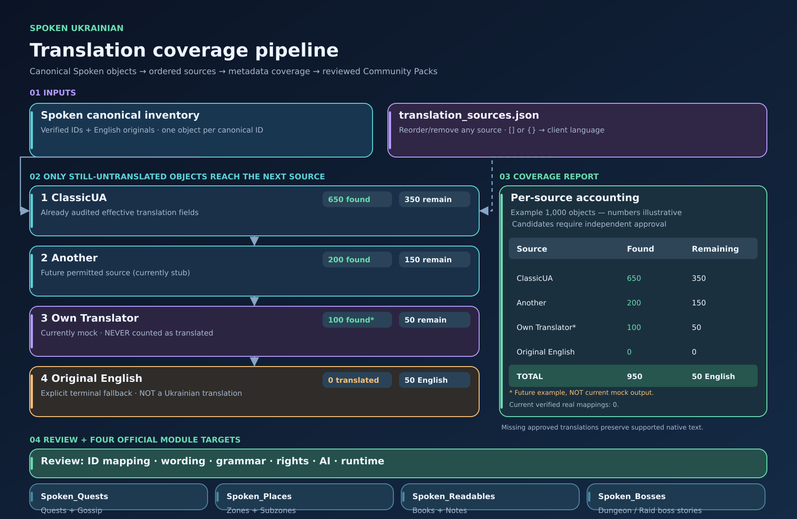

# Spoken Ukrainian 🇺🇦

[Посібник з командного рядка](docs/CLI.uk.md) · [English CLI guide](docs/CLI.md)

**[English](README.md) | [Українська](README.uk.md)**

**Spoken Ukrainian** — спільнотний проєкт української текстової локалізації та майбутнього українського озвучування для [Spoken](https://github.com/rusty-key/spoken-wow) у **World of Warcraft Forever**. Він розвивається як незалежний набір Spoken Community Packs (пакетів спільноти), а оригінальний Spoken Player встановлюється окремо.

> **Стан розробки:** реєстрацію української мови та оригінальний **діагностичний текстовий пакет Places** реалізовано й перевірено вручну у Forever. Адаптер джерел ClassicUA також готовий. Повноцінні українські пакети завдань, діалогів, книг, описів локацій та історій босів **ще не випущено**.

## Python-оточення: uv

Для роботи з Python-інструментами використовуємо [uv](https://docs.astral.sh/uv/) та **Python 3.12**. У репозиторії є `pyproject.toml`, `.python-version` і закріплений `uv.lock`; це **не Python-пакет**, а відтворюване оточення для CLI. Встанови uv за [офіційною інструкцією](https://docs.astral.sh/uv/getting-started/installation/), потім у корені репозиторію:

```bash
uv sync --locked
uv run --locked python -m unittest discover -s tests -v
uv run --locked python tools/build_ukrainian.py --classicua ../ClassicUA --spoken ../spoken-wow
```

**Встановлення білда в WoW Forever без ручного розпакування:**

```bash
uv run --locked python tools/install_addon.py --addons "/шлях/до/WoW/Interface/AddOns" --dry-run
uv run --locked python tools/install_addon.py --addons "/шлях/до/WoW/Interface/AddOns"
```

Замінити шлях потрібно на **реальну директорію AddOns**. Скрипт перевіряє SHA-256 та структуру ZIP, замінює **лише** `Spoken_Ukrainian` і `Spoken_Quests_UA`, зберігає попередні версії в прихованій `.spoken-ukrainian-backups/` і не змінює офіційні аддони. Перед встановленням **повністю закрий гру**. `--dry-run` не змінює файли. [Детальніше](docs/QUEST_LOCAL_TEST_BUILD.md#safe-local-addon-installer-with-uv).

## Виправлення за перевіркою у WoW Forever (Gossip / українські літери)

У локальному Quest UI декоративний шрифт назви квесту не мав усіх
українських гліфів. Тепер для **перекладеного** заголовка використовується
шрифт основного тексту квесту зі збереженням розміру. Під час утримання
**Shift** відновлюються і оригінальний текст, і шрифт.

**Назви доступних/активних квестів** у Gossip і Quest Greeting також
підтягуються з аудованого ClassicUA за **точним Quest ID і фракцією**.
Це окремі *title-only* дані, які експортуються лише в локальний ZIP
і **не збільшують кількість імпортованих текстів озвучення Spoken**.
Для Quest 97279 назва може з’явитися у списку NPC, навіть якщо
опис/діалог ще не має допустимої відповідності у корпусі Spoken.
Причини такого відсіву друкуються в консолі білда.

## Локальний тестовий білд Spoken Ukrainian (Quests)

Проєкт створює **два окремі встановлювані аддони**: базовий `Spoken_Ukrainian` із назвою **Spoken Ukrainian** та Quest-модуль `Spoken_Quests_UA` (**Spoken Ukrainian: Quests**). Офіційні `Spoken` і `Spoken_Quests` не змінюються. **При кожному білді автоматично запускається автоімпорт ClassicUA 1:1**; відсутні/некоректні pinned checkouts або відсутність однозначних Quest-перекладів зупиняють збірку.

```sh
uv run --locked python tools/build_ukrainian.py --classicua ../ClassicUA --spoken ../spoken-wow
```

**AI-переклади ClassicUA:** необов’язковий прапорець `allow_ai_transations` (саме таке написання) за замовчуванням `false`, але в поточному `config/translation_sources.json` для `classicua` встановлено **`true`**. Він дозволяє тільки попередній локальний автоімпорт AI-записів, які пройшли суворе зіставлення 1:1; не означає людського схвалення перекладу. Зміна на `false` та повторний білд виключає AI-записи з активного тестового ZIP, не стираючи локальну історію імпорту. Не всі AI-переклади ClassicUA гарантовано існують у корпусі Spoken.

Результат у приватному `dist/Spoken_Ukrainian_Quest_Local_Test.zip` (два каталоги аддонів + SHA-256). Розпакуй у `Interface/AddOns/`, увімкни **Spoken Ukrainian** і **Spoken Ukrainian: Quests**; **ClassicUA у грі більше не потрібен** для підтриманих квестових полів, але його Git-копія потрібна під час білда. У PR #20 **штатне вікно NPC QuestFrame** показує український переклад за замовчуванням; **утримуй Shift для англійського оригіналу**, відпусти — знову українська. Додаткова тестова панель `/spokenuk preview on` залишається опційною. Це **ще не штатні субтитри Spoken** — для них pinned Spoken 3.9.0 вимагає справжніх аудіоданих. **Це локальний тест, не реліз.** [Інструкція та приймальні тести у грі](docs/QUEST_LOCAL_TEST_BUILD.md#native-questframe-translation-issue-19).

Той самий тестовий аддон **`Spoken_Quests_UA`** тепер містить і переклад **Gossip-реплік NPC та варіантів відповідей**: `GossipFrame.lua` читає згенерований `GossipTranslations.lua`, зіставляючи точний **NPC ID** та хеш оригінального англійського тексту з перевіреного pinned ClassicUA. Раніше реалізований `GossipQuestTitles.lua` і далі відповідає за назви квестів. **Shift** тимчасово показує англійський оригінал, відсутній переклад залишає англійський текст, а встановлений ClassicUA має пріоритет. Це лише **попередній локальний переклад штатного Gossip UI**, не схвалене зіставлення canonical ID Spoken, не субтитри озвучення й не реліз. **Окремий `Spoken_Gossip_UA` встановлювати не потрібно.**

**Розширення перекладу Gossip:** аудит закріплених джерел Spoken/ClassicUA виявив **5 047 неперекладених реплік NPC**, які після дедуплікації зводяться до **3 109 унікальних англійських текстів** (1 938 повторів та 418 груп фраз, спільних для кількох NPC). Команда `uv run --locked python tools/gossip_translation_review.py queue --classicua ../ClassicUA --spoken ../spoken-wow` формує **78 приватних JSON-пакетів**. У вже наявному локальному вебінтерфейсі є окрема секція **Gossip Translation Review · NPC**: нова версія спочатку pending, далі ручна перевірка усіх NPC-контекстів, Approve/Reject/Defer та **окремий Import approved**. У цьому ручному процесі лише явно імпортовані й досі схвалені переклади потрапляють до тестового ZIP, не замінюючи ClassicUA. Один обраний пакет можна перекласти командою `uv run --locked python tools/gossip_translate_codex.py --input build/gossip-batches/batch-0001.json --apply` (один явний виклик Codex; можливе використання квоти моделі; жодного автоматичного Approve/Import). API перекладача під час звичайної збірки не викликається; публікації немає. [Покроковий процес і промпт Codex](docs/GOSSIP_TRANSLATION_REVIEW.md).

**Машинний імпорт ClassicUA Gossip:** окремий provisional-процес 1:1 зберігає перевірені NPC/hash та дедупліковані common-збіги в SQLite, оновлюється перед кожною локальною тестовою збіркою й має секцію **Автоімпорт Gossip 1:1 · ClassicUA** з фільтрами в Review UI. Машинні імпорти не мають людського схвалення; ручні рішення та вибір джерел зберігаються, а змінені докази отримують `pending_update`. Статистика розрізняє унікальні тексти, входження NPC/hash, common fallback та фактичний вміст ZIP. [Інструкція, статуси й тести Forever](docs/GOSSIP_MACHINE_IMPORT.md).

**Постійне сховище перекладів:** консольні інструменти Quests і Gossip за замовчуванням використовують приватну базу SQLite (`~/.local/share/spoken-ukrainian/translations.sqlite3` або `$XDG_DATA_HOME`). Існуючі JSON з `build/` імпортуються без видалення, а наступні збірки повторно використовують збережені версії та рішення рев'юверів. Раніше схвалений Gossip-переклад або однозначна pending-чернетка можуть заповнити **чернетку** нового NPC-контексту, але не схвалюється повторно автоматично. [Міграція, резервні копії та захист даних](docs/SQLITE_TRANSLATION_STORE.md).

Перед резервним копіюванням перевірте налаштовану базу. **Лише для нового сховища** явно виконайте `init`; якщо зникли попередні рішення рев'юверів, спочатку знайдіть або відновіть їхню базу.

```bash
uv sync --locked
uv run --locked python tools/translation_db.py status
uv run --locked python tools/translation_db.py init
uv run --locked python tools/translation_db.py backup
# Optional: choose an unused private backup file.
uv run --locked python tools/translation_db.py backup --output ~/backups/spoken-translations.sqlite3
```

Додавайте `--db /path/to/translations.sqlite3` до кожної команди або задайте `SPOKEN_TRANSLATION_DB` для всіх інструментів. `status` лише читає дані; `backup` потребує наявної бази, не ініціалізує її та не перезаписує резервну копію. Символічні посилання у шляхах джерела й призначення, включно з батьківськими директоріями, відхиляються. Діагностика показує локальні шляхи та способи виправлення без текстів перекладів; приховайте особисті шляхи перед поширенням журналів.

**Порівняння джерел (нове):** SQLite зберігає незмінні знімки кожної ревізії ClassicUA та інших джерел, порівнює старі й нові переклади, показує конфлікти й вимагає **п'ять ручних перевірок та окремий активний вибір**. Ручний вибір зберігає конкретну версію джерела й перевіряється за поточним оригіналом Spoken. [Покрокова робота з ревізіями та UI](docs/SOURCE_REVISION_REVIEW.md). Застосування лише в локальному тестовому ZIP, без публічного релізу.

**Статистика імпорту:** локальний Review UI показує таблицю **Translation Import Statistics** — кількість імпортованих Quest-подій, NPC-реплік Gossip, спільних Gossip-текстів та назв квестів з розподілом за джерелами. Окремо видно поточні Review-імпорти, вибрані версії джерел і фактично включені тексти останнього тестового ZIP. [Визначення показників та CLI-команди](docs/IMPORT_STATISTICS.md).

## Архітектура та пошук перекладів

Spoken Ukrainian готує український контент **офлайн** для **незміненого Spoken Player**. Знайдений переклад ще **не означає** схвалений canonical ID, якісний текст, право на публікацію або сумісність із грою.

### Нові пріоритети реалізації (листопад 2026)

**Спочатку:** (P0) історії **Places**, (P1) **Books and Notes** (`Spoken_Readables`), (P2) історії **Bosses**, (P3) елементи **інтерфейсу Compendium** (заголовки, вкладки, кнопки, фільтри, пошук і повідомлення), (P4) **Quests/Gossip**. Попередні інструменти перевірки зберігаємо.

Compendium — спільне вікно `Spoken`, **не п'ятий модуль**. Після перекладу контенту Places, Readables і Bosses окремо повернемося до його елементів керування. ClassicUA містить **назви локацій**, але не готові повні оповіді Places. Аддон [UA VoiceOver: Books & Lore](https://www.curseforge.com/wow/addons/ua-voiceover-books-lore) заявляє близько 900 українських історій і понад 1000 озвучених сторінок — це **перспективне, але ще не перевірене джерело**. Див. [roadmap](docs/PRODUCT_PRIORITIES_2026_11.md) та [аудит Places](docs/PLACES_SOURCE_AUDIT.md).

### Чотири затверджені модулі

| Офіційний модуль | Український контент |
| --- | --- |
| `Spoken_Quests` | Завдання **та Gossip** (один модуль) |
| `Spoken_Places` | Історії зон і підзон (колишній Spoken Zones) |
| `Spoken_Readables` | Книги, листи, записки, таблички (колишній Spoken Books) |
| `Spoken_Bosses` | Історії босів підземель і рейдів |

Ми плануємо чотири незалежні українські пакети контенту, **не змінюючи офіційні модулі**. ClassicUA не містить готових авторських історій для Places і Bosses. Див. [затверджену архітектуру та fallback](docs/APPROVED_MODULES_AND_FALLBACK.md).

### Джерела та їхній пріоритет

Порядок задається у [`config/translation_sources.json`](config/translation_sources.json):

```json
{
  "schema_version": 2,
  "sources": [
    {"name": "classicua", "save_translations": true, "auto_approve_one_to_one": true, "allow_ai_transations": true},
    {"name": "another", "save_translations": false},
    {"name": "own_translator", "save_translations": true},
    {"name": "original_english", "save_translations": false}
  ]
}
```

| Джерело | Поточний стан | Призначення |
| --- | --- | --- |
| `classicua` | Реалізований адаптер | Читає ефективні переклади ClassicUA; відповідність ID ще треба перевірити |
| `another` | Офлайн-заглушка | Майбутнє джерело з перевіреними правами; наразі результатів немає |
| `own_translator` | Mock без права публікації | **Не рахується перекладом** і не займає запис |
| `original_english` | Явний fallback | Використовує англійський оригінал для залишку, але не рахується українським перекладом |

**Об'єкти джерел можна переставляти або прибирати.** Наприклад, якщо перемістити `own_translator` перед `classicua`, зміниться пріоритет (перекладач поки mock); якщо залишити лише `original_english`, обиратиметься тільки англійська. **`{"schema_version":2,"sources":[]}` або `{}` означає реальну мову клієнта WoW**, без виклику перекладачів; клієнт `deDE` не перемикається на англійську. Реальну локаль передає викликач. Старі списки назв зі schema v1 також працюють, але всі прапорці збереження для них вимкнено. `original_english` не додається приховано. Відсутній чи некоректний конфігураційний файл — помилка.

**Назви й перевірка у грі:** імпортер PR #17 називається **Quest Translation Import · Spoken_Quests (offline)**. Це **не аддон**: він зберігає українські Quest-тексти лише в приватному `build/`. Офіційний модуль `Spoken_Quests` залишаємо без змін. У PR #18 вже створено окремий локальний тестовий модуль `Spoken_Quests_UA` та базовий аддон `Spoken_Ukrainian`. Наявний `SpokenCommunity_ukrainian-diagnostic` — це **Places**, його не перейменовуємо на Quests. **У PR #20 пакет перекладає також штатне NPC-вікно квесту**, а опціональне preview залишається окремим; це не штатні субтитри Spoken: [покрокове встановлення та перевірка](docs/QUEST_LOCAL_TEST_BUILD.md).

**Масовий імпорт ClassicUA 1:1:** у локальному Review UI є кнопка **«Автоімпорт 1:1 · ClassicUA»**. Вона виконує оновлення кандидатів, автоматичне схвалення підтверджених однозначних записів і явний **неактивний локальний** імпорт. Унизу відображається таблиця: кількість канонічних Spoken ID (включно з усіма модулями), знайдені однозначні кандидати, підтверджені зв'язки, імпортовані переклади за джерелом, записи без імпорту та відсоток покриття. Для масового запуску через термінал:

```sh
uv run --locked python tools/review_ui_server.py --classicua /path/to/ClassicUA --spoken /path/to/spoken-wow --auto-import-one-to-one
```

Строго однозначні Quest-відповідності (унікальний source і target, один перевірений контекст Spoken та наявний англійський оригінал) можуть автоматично зберігатися як **попередній машинний імпорт** у `build/machine-one-to-one.json` навіть без Stage 3 review. Це не є людським апрувом mapping і не дозволяє включати текст у реліз. Після незалежного mapping review переклад переходить до звичайного перевіреного локального імпорту, а машинний запис не перезаписує його. У таблиці машинні імпорти показано окремою колонкою. У типовій конфігурації ClassicUA автоапрув увімкнено; для інших джерел вимкнено. Фактичне збереження — у приватному `build/translation-reviews.json`, не у Git та не у WoW. [Процедура й обмеження](docs/TRANSLATION_APPROVALS.md).

**Необов'язковий `auto_approve_one_to_one: true`** (спочатку лише ClassicUA; за відсутності прапорця — `false`; у типовій конфігурації ClassicUA — `true`) дозволяє автоматично схвалити та зберегти у приватному локальному сховищі `build/translation-reviews.json` один однозначний переклад **після незалежно затвердженої відповідності ID**, перевірки прав та відсутності альтернативних кандидатів. Запускається через Refresh у Review UI; рішення позначається як `auto_approved_1to1`, без удаваного людського рев’ю якості. Змінені тексти й ручні редакції залишаються на перевірку. Імпорт у неактивний локальний snapshot залишається окремою дією, а автоматичного запису текстів у Git чи публікації немає. [Умови автоапруву](docs/TRANSLATION_APPROVALS.md).

**Параметр `save_translations` задається окремо для кожного джерела** й дозволятиме зберігати перевірені переклади у Git (`translations/ukUA/`). Під час поточного пошуку кандидатів файли **ще не записуються**: потрібні підтверджені ID, походження, права й рев’ю. Імпортовані тексти зберігатимуться окремо від наших редакцій; оновлення джерела проходитимуть через перевірку, а не автоматичний перезапис. `own_translator` поки mock, тому навіть із `true` нічого не зберігає. [Політика зберігання й оновлення](docs/TRANSLATION_STORAGE_POLICY.md).

### Послідовна обробка та звіт

1. Отримуємо список **перевірених canonical ID Spoken** та оригінальні англійські тексти/докази ідентичності. Наразі список передає викликач.
2. Кожне джерело отримує **лише записи, для яких попередні не знайшли реального українського кандидата**. Зберігаємо ID, джерело, SHA-256 поля та статус `candidate_pending_review`.
3. Mock не закриває записи. Англійський оригінал і мову клієнта обліковуємо окремо: це **не українські переклади**.
4. Формуємо **звіт лише з метаданими**: нові кандидати кожного джерела, залишок і загальна кількість; без повних текстів.
5. Перед пакуванням потрібні незалежні перевірки відповідності ID, тексту/граматики/AI, прав та роботи у WoW.

**Синтетичний приклад, не реальне покриття:**

| Джерело | Нові українські кандидати | Залишок для наступного |
| --- | ---: | ---: |
| ClassicUA | 2 | 2 |
| Another (заглушка) | 0 | 2 |
| Own Translator (mock) | 0 | 2 |
| Original English | 0 (2 англійські оригінали) | 0 |
| **Всього: 4 записи** | **2 очікують перевірки** | **2 лише англійською** |

Звіт розділяє кількість кандидатів та `approved_translations` (**зараз нуль**), англійську/мову клієнта й нерозв’язані записи. Це **офлайн-прототип**, який ще не підключено до `tools/stage3_report.py` або фінального збирача Community Packs. **Жодного реального зіставлення ClassicUA ↔ Spoken не схвалено.**



[Редагована схема draw.io](docs/diagrams/translation-pipeline.drawio) · [Правила джерел і статистика](docs/TRANSLATION_SOURCE_CHAIN.md) · [Stage 3: відповідності ID](docs/STAGE_3_IMPLEMENTATION.md)

### Сумісність та оновлення

`ukUA` — **мова контенту Spoken**, а не локаль Blizzard. Український текст без аудіо вже працює у діагностичному Places, але Quests/Gossip, Readables і Bosses мають невирішені обмеження субтитрів, мови або аудіо. **Налаштування офлайн-джерел не створює fallback безпосередньо у грі**. Див. [Stage 2B](docs/STAGE_2B_COMPATIBILITY.md).

У майбутньому українські пакети мають працювати без встановленого аддона ClassicUA. Переклади ClassicUA залишаються **закріпленим вхідним джерелом**; зміни ефективного тексту потребують перевірки контенту/аудіо, але не обов’язково зміни canonical ID. Збирання пакетів, TTS і публікація — окремі майбутні етапи.

## ClassicUA та авторство

Основним запланованим джерелом українських ігрових перекладів і термінології є **[ClassicUA](https://github.com/greenya/ClassicUA)**. Щиро дякуємо команді та всім учасникам ClassicUA за розвиток української локалізації World of Warcraft!

У [ClassicUA Issue #100](https://github.com/greenya/ClassicUA/issues/100#issuecomment-6917008199) автор **greenya** дозволив використовувати й адаптувати переклади ClassicUA в Spoken Ukrainian, створювати на їхній основі AI TTS-озвучування та поширювати його. У відповіді підтверджено, що дозвіл охоплює переклади репозиторію, а додаткових обмежень щодо публікації немає. Автор попросив додати посилання на проєкт і зазначити, що переклади були адаптовані.

> **За основу взято адаптовані переклади [ClassicUA](https://github.com/greenya/ClassicUA).**

Це зазначення авторства стосується **майбутніх матеріалів на основі ClassicUA**. Наявний діагностичний текст створено спеціально для цього проєкту: він не містить запозичених перекладів ClassicUA. Дозвіл не поширюється автоматично на сторонні зображення, шрифти чи історії з інших джерел і не скасовує умови майбутнього TTS-провайдера. Дивіться [запис про дозвіл](docs/CLASSICUA_PERMISSION.md) та [відомості про сторонні матеріали](THIRD_PARTY.md).

## Поточний стан

| Компонент | Стан |
| --- | --- |
| Stage 0 — архітектура, аналіз джерел і сумісності | Завершено |
| Stage 1 — реєстрація `ukUA` й оригінальний текстовий діагностичний пакет Places | Реалізовано; перевірено у Forever |
| Stage 2A — обмежений парсер Lua, перевизначення ClassicUA та аудит метаданих | Реалізовано |
| Stage 2B — сумісність модулів із незалежним українським текстом | Офлайн-перевірки реалізовано; [результати](docs/STAGE_2B_COMPATIBILITY.md), [перевірка у Forever очікує виконання](docs/STAGE_2B_TESTING.md) |
| Stage 3 — зіставлення ClassicUA з ID Spoken та модель майбутніх оновлень | Локальний індекс, схема перевірки та порівняння реалізовані; **0 схвалених реальних відповідностей, незалежна перевірка очікується** ([покриття](docs/STAGE_3_IMPLEMENTATION.md)) |
| Налаштовувані джерела та послідовна звітність (PR #8) | Офлайн-прототип пошуку, конфігурація й звіт; **реальні переклади не схвалені** |
| Stage 4A — реальний індекс Spoken → звіт за джерелами | Реалізовано читання перевірених англійських текстів із закріплених джерел і офлайн-CLI; **0 схвалених зіставлень, немає українських пакетів** ([деталі](docs/STAGE_4A_INVENTORY_COVERAGE.md)) |
| Stage 4B — Workbench перевірки Quest mapping | Черга з перевірених джерел, відхилення/відкладення, Stage 3 JoinProof від двох reviewer; **0 реальних схвалених відповідностей** ([процедура](docs/STAGE_4B_REVIEW_WORKBENCH.md)) |
| Stage 4C — основа перевіреної прив'язки Quest | Лише синтетичні тести перевірки ефективних полів ClassicUA; **0 реальних mapping і схвалених текстів**, без CLI ([контракт](docs/STAGE_4C_REVIEWED_QUEST_BRIDGE.md)) |
| Stage 4B.2 — локальний Quest Review UI | Окремі Mapping/Translation Review, незалежні proofs, локальні версії/рішення та явний інертний імпорт; **без реальних схвалень або активації** ([інструкція](docs/STAGE_4B_LOCAL_REVIEW_UI.md)) |
| **Поточний пріоритет** | **Places → Readables (книги/нотатки) → Bosses → Compendium UI → Quests/Gossip** ([roadmap](docs/PRODUCT_PRIORITIES_2026_11.md)) |
| Українські текстові й аудіопакети, оновлювач і публічні релізи | Ще не випущено |

## Збирання та тестування

Наразі локально можна зібрати **лише діагностичний пакет**, а не повноцінну українську локалізацію.

```sh
uv run --locked python tools/version.py check
uv run --locked python tools/build.py
uv run --locked python -m unittest discover -s tests -v
```

Для збирання потрібен Python 3. Для тестів додатково знадобляться Git, системна бібліотека Lua 5.4 та копія вихідного коду Spoken на закріпленій ревізії (зазвичай у сусідній директорії `../spoken-wow`). Якщо Spoken розташований в іншому місці, задайте `SPOKEN_SOURCE=/absolute/path/to/spoken-wow`. Ці команди не завантажують вихідний код, не встановлюють пакети та не звертаються до робочих сервісів.

Збірка створює `dist/SpokenCommunity_ukrainian-diagnostic.zip` і файл перевірки SHA-256. Архів містить тільки файл аддона `.toc` та `Lore.lua` з оригінальним текстом для перевірки мови й шрифтів у Elwynn Forest (ID мапи 1429). **Не копіюйте весь репозиторій до папки AddOns.** Інструкції зі встановлення наведено в [посібнику Stage 1](docs/STAGE_1_TESTING.md).

### Перевірка canonical ID (Stage 3)

```sh
uv run --locked python tools/stage3_report.py --classicua /absolute/path/to/clean-pinned-ClassicUA --spoken /absolute/path/to/spoken-wow
```

Детермінований звіт із метаданими записується до ігнорованого `build/stage3-report.json`. Опції `--reviews` та `--candidate` з `--candidate-manifest` перевіряють збережені рішення й окрему локальну ревізію без зміни закріпленого джерела. Це ще **не запуск pipeline джерел перекладу**. Див. [документацію Stage 3](docs/STAGE_3_IMPLEMENTATION.md).

### Офлайн-покриття реальних ID Spoken (Stage 4A)

```sh
uv run --locked python tools/stage4_coverage.py --spoken /absolute/path/to/clean-pinned-spoken-wow
```

Інструмент читає **справжній закріплений індекс canonical ID Spoken**, перевіряє оригінальні тексти Quests/Gossip/Readables без їхнього експорту й записує звіт про джерела, записи без підтвердженого оригіналу та загальну кількість до `build/stage4-source-coverage.json` (ігнорується Git). Прив’язка до ClassicUA **навмисно вимкнена**, доки немає незалежно схвалених Stage 3 зіставлень. `another` — заглушка, `own_translator` — mock. Для порожньої конфігурації клієнтську локаль необхідно передати через `--client-locale`. Див. [межі Stage 4A](docs/STAGE_4A_INVENTORY_COVERAGE.md).

### Перевірка кандидатів Quest mapping (Stage 4B)

Workbench аудіює **обидва закріплені репозиторії**, формує чергу справжніх кандидатів за Quest ID/event (лише метадані) і вимагає незалежної перевірки NPC, голосу, faction та оригінального тексту перед зіставленням:

```sh
uv run --locked python tools/stage4b_workbench.py \
  --classicua /absolute/path/to/clean-pinned-ClassicUA \
  --spoken /absolute/path/to/clean-pinned-spoken-wow \
  --faction horde --limit 40
```

Результати: ігноровані `build/stage4b-review-queue.json` і **CSV-таблиця для перевірки** `build/stage4b-review-worksheet.csv` (один рядок на кандидатний target/voice-варіант). CI прикріплює файли як короткоживучий артефакт із метаданими. Reviewer може **відхилити або відкласти** кандидатуру. **Схвалення canonical ID** потребує окремого `JoinProof` від реальних людей і двох різних reviewer; воно не схвалює автоматично український текст. Жодних реальних схвалень не додано. Див. [Stage 4B — процедуру](docs/STAGE_4B_REVIEW_WORKBENCH.md).

### Перевірена прив'язка Quest-перекладів (основа Stage 4C)

`adapters/reviewed_bridge.py` реалізує **синтетично протестоване** офлайн-зв'язування незалежно схвалених Stage 3 Quest mappings із точними ефективними полями ClassicUA. Повторно перевіряються докази, SHA-256 тексту та пріоритет джерел; знайдений український текст залишається **кандидатом на окрему перевірку**, а не схваленим перекладом. Звичайна команда Stage 4A **не використовує цей модуль**, і **реальних схвалених відповідностей досі нуль**. Див. [Stage 4C](docs/STAGE_4C_REVIEWED_QUEST_BRIDGE.md).

### Локальний Quest Review UI (Stage 4B.2)

**Локальний вебінтерфейс** розділяє Mapping Review і Translation Review. Порівнюйте перевірені UA/EN та speaker/voice/faction, відхиляйте/відкладайте mappings або подавайте повний людський Stage 3 `JoinProof` із **двома незалежними reviewer**. Перевірені joins дають pending-переклади. Редагуйте нові версії, переглядайте provenance/історію та окремо схвалюйте текст/граматику/AI/права. **Approval та імпорт — окремі дії**; імпорт створює лише інертний локальний snapshot без активації у WoW. Реальних схвалень у цьому PR немає.

```sh
uv run --locked python tools/review_ui_server.py \
  --classicua /absolute/path/to/clean-pinned-ClassicUA \
  --spoken /absolute/path/to/clean-pinned-spoken-wow
```

Відкрийте **http://127.0.0.1:8765/** на цьому ж комп'ютері. Сервер слухає лише loopback, не звертається до Інтернету й зберігає приватні дані в ігнорованому `build/`: метадані у `stage4b-decisions.json` та `stage3-ui-reviews.json`, локальні тексти/історію/import references у `translation-reviews.json`. Необов'язковий `store_locally` керує зберіганням провайдера. Незмінні байти/контекст можуть зберегти approval після аудиту оновлених джерел; змінені текст/оригінал/контекст стають stale, ручні правки залишаються в історії. Наявні v2 рішення сумісні; пошкоджені/старі файли потребують відновлення й явного повторного review. [Процедура UI та recovery](docs/STAGE_4B_LOCAL_REVIEW_UI.md), [архітектура approvals](docs/TRANSLATION_APPROVALS.md).

Явний імпорт (ті самі необов'язкові шляхи/політика, що й у UI):

```sh
uv run --locked python tools/review_ui_server.py \
  --classicua /absolute/path/to/clean-pinned-ClassicUA \
  --spoken /absolute/path/to/clean-pinned-spoken-wow \
  --import-approved
```

Перевірка: `uv run --locked python tools/version.py check`, `uv run --locked python tools/build.py` та `uv run --locked python -m unittest discover -s tests -v` (включно з локальними HTTP sockets).

### Аудит закріпленої ревізії ClassicUA (Stage 2A)

```sh
uv run --locked python tools/classicua_audit.py --source /absolute/path/to/clean-pinned-ClassicUA
```

Адаптер читає **окрему, незмінену робочу копію** ClassicUA на ревізії з [sources.lock.json](sources.lock.json), перевіряє хеші файлів та враховує реальний порядок завантаження й перевизначень `classic → sod → forever`. Звіт містить лише метадані й зберігається в ігнорованому Git файлі `build/classicua-audit.json`. Адаптер не виконує Lua-код ClassicUA, не створює пакетів із перекладеним текстом і поки не зіставляє записи з канонічними ID Spoken. Дивіться [опис реалізації](docs/STAGE_2A_IMPLEMENTATION.md) і [результати тестів](docs/STAGE_2A_TESTING.md).

## Версійність проєкту

Кореневий файл [VERSION](VERSION) містить **версію проєкту** (початкова — `0.0.1`), яка не залежить від версій окремих аддонів (діагностичний пакет має `0.1.0`). Команди `uv run --locked python tools/version.py show` і `uv run --locked python tools/version.py check` показують і перевіряють версію; історію змін ведемо в [CHANGELOG.md](CHANGELOG.md). Git-теги та GitHub Releases створюються окремо після перевірки, а не автоматично під час підвищення версії. Докладніше — у [VERSIONING.md](docs/VERSIONING.md).

## Документація

- [План реалізації](docs/IMPLEMENTATION_PLAN.md) · [Інтеграція джерел](docs/SOURCE_INTEGRATION.md) · [Матриця сумісності](docs/COMPATIBILITY_MATRIX.md)
- [Специфікація Stage 3](docs/STAGE_3_SPECIFICATION.md) · [Дозвіл ClassicUA](docs/CLASSICUA_PERMISSION.md) · [Авторство й сторонні матеріали](THIRD_PARTY.md)
- [Stage 4A: офлайн-покриття](docs/STAGE_4A_INVENTORY_COVERAGE.md) · [Джерела перекладу та звітність](docs/TRANSLATION_SOURCE_CHAIN.md) · [Редагована схема](docs/diagrams/translation-pipeline.drawio) · [Чотири модулі](docs/APPROVED_MODULES_AND_FALLBACK.md)
- [Посібник зі створення Spoken Community Packs](https://github.com/rusty-key/spoken-wow/blob/master/community/README.md)

Документи Stage 0 зберігають **історичний стан на момент їх створення**, зокрема попередню згадку про відсутність дозволу. Отримане згодом погодження зафіксоване окремо, щоб не змінювати історичні документи та їхні контрольні суми.
